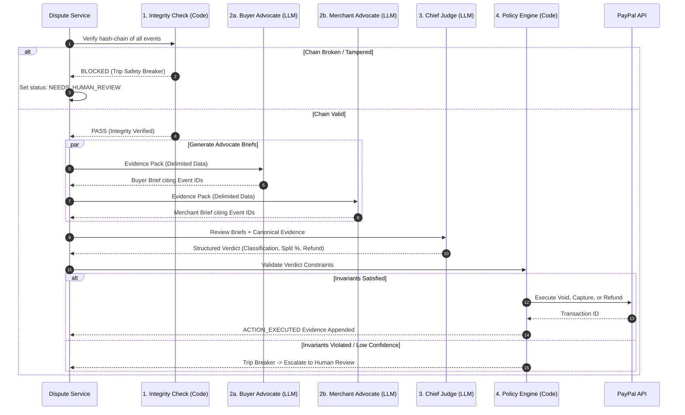

# NetraBox — Technical Architecture Blueprint

> **System Design & Implementation Guide**  
> Built for the _"Build What's Next with PayPal and AI"_ Hackathon.

NetraBox acts as an immutable flight recorder and autonomous dispute tribunal for AI-agent purchases. This document details the system topology, transaction state transitions, cryptographic protocols, multi-agent arbitration workflow, and PayPal settlement mechanics.

---

## 1. System Topology & High-Level Architecture

```mermaid
flowchart TD
    subgraph ClientLayer["Client & Agent Layer"]
        User["User / Shopper"]
        BuyerAgent["Autonomous Buyer Agent\n(Gemini 1.5 Flash + SDK Recorder)"]
        Dashboard["Next.js 14 Dashboard\n(App Router + Tailwind)"]
    end

    subgraph NetraBoxCore["NetraBox Platform (Fastify API)"]
        IntentGuard["Intent Guard\n(Structural Constraints + Delimited Sanitizer)"]
        EvidenceService["Evidence Ledger Service\n(SHA-256 Chaining + Ed25519 Signatures)"]
        StateMachine["Atomic State Machine\n(Transaction Table)"]
        PolicyEngine["Deterministic Policy Engine\n(Pure Code Financial Validator)"]

        subgraph TribunalEngine["Autonomous Tribunal Courtroom"]
            IntegrityCheck["1. Deterministic Integrity Check"]
            Advocates["2. Buyer & Merchant Advocates\n(Delimited Telemetry Citation)"]
            JudgeAgent["3. Chief Judge Agent\n(Structured Verdict Output)"]
        end
    end

    subgraph StorageLayer["Data & Persistence"]
        Postgres[(PostgreSQL 16\nDrizzle ORM)]
    end

    subgraph PayPalRails["PayPal Sandbox (Orders v2 API)"]
        PPAuth["OAuth 2.0 Token Manager\n(Bearer Token Caching)"]
        PPOrder["Orders v2 (intent: AUTHORIZE)"]
        PPSettlement["Capture / Void / Refund Rails"]
        PPWebhooks["Webhook Signature Verifier"]
    end

    User -->|Prompts & Budget| BuyerAgent
    BuyerAgent -->|wrapTool Telemetry| EvidenceService
    BuyerAgent -->|Propose Cart| IntentGuard
    IntentGuard -->|PASS / WARN / BLOCK| StateMachine

    StateMachine -->|1. Create Order (AUTHORIZE)| PPOrder
    User -->|2. PayPal Sandbox Approval| PPOrder
    PPOrder -->|3. Authorize Hold| StateMachine

    PPWebhooks -->|Fulfillment Scan| StateMachine
    StateMachine -->|On-Time Delivery| PPSettlement

    User -->|Open Dispute| TribunalEngine
    TribunalEngine --> IntegrityCheck
    IntegrityCheck -->|Valid Chain| Advocates
    Advocates --> JudgeAgent
    JudgeAgent --> PolicyEngine
    PolicyEngine -->|Execute Void or Refund| PPSettlement

    EvidenceService <--> Postgres
    StateMachine <--> Postgres
    Dashboard <--> NetraBoxCore
```

---

## 2. End-to-End Purchase & Dispute Lifecycle

1. **Instruction & Constraint Extraction**:
   - The user commands the buyer agent (e.g., _"Buy Sony XM5 wireless headphones, brand new under \$360"_).
   - SDK recorder wraps the tool call and logs `INSTRUCTION_RECEIVED` to the append-only ledger.
2. **Intent Guard Verification**:
   - Intent Guard converts user constraints into strict Zod schemas and compares prospective merchant items against them.
   - Any prompt injection in product listings is quarantined inside XML-delimited blocks. Deviances trip `BLOCK`, immediately voiding the transaction before money touches payment rails.
3. **PayPal Orders v2 Authorization Hold**:
   - Instead of capturing money upfront, NetraBox calls PayPal Orders v2 with `intent: "AUTHORIZE"`.
   - The buyer approves via PayPal OAuth sandbox. Funds are reserved on the buyer's payment instrument (`AUTHORIZED` state).
4. **Fulfillment & Cryptographic Delivery Recording**:
   - The merchant confirms carrier dispatch and tracking.
   - NetraBox records signed `DELIVERY_EVENT` evidence.
   - If fulfillment is satisfactory, the authorization is captured (`CAPTURED`).
5. **Autonomous Tribunal Dispute Resolution**:
   - If an issue arises (wrong size, defective goods, partial shipment, fraud claim), a dispute is opened (`DISPUTED`).
   - The 4-step tribunal executes:
     - **Step 1**: Deterministic verification of the evidence hash-chain.
     - **Step 2**: Adversarial briefs from Buyer and Merchant advocate agents citing exact evidence sequence IDs.
     - **Step 3**: Gemini Chief Judge synthesizes arguments, outputs classification and liability split.
     - **Step 4**: Deterministic Policy Engine validates constraints ($0 \le \text{refund} \le \text{captured}$) and executes the corresponding PayPal settlement action.

---

## 3. Cryptographic Evidence Protocol

Every evidence record is cryptographically tied to its preceding history. This guarantees that no transaction step can be injected, deleted, reordered, or modified without immediate detection.

### 3.1 Event Hash Chaining

For event at sequence $i$:
$$\text{body}_i = \{\text{purchaseId}, \text{seq}_i, \text{type}_i, \text{actor}_i, \text{payload}_i, \text{prevHash}_i, \text{signerKeyId}_i\}$$
$$\text{hash}_i = \text{SHA-256}(\text{prevHash}_i \mathbin{\Vert} \text{CanonicalJSON}(\text{body}_i))$$
$$\text{signature}_i = \text{Ed25519-Sign}(\text{hash}_i, \text{privKey}_{\text{system}})$$

Where $\text{prevHash}_1 = 0^{64}$ (64 hexadecimal zeros).

### 3.2 Canonical JSON Encoding

To prevent ambiguity from key ordering, floating-point string conversions, or whitespace differences, all payloads undergo strict canonical sorting:

- Object keys are recursively sorted lexicographically by UTF-8 code point.
- Whitespace is removed outside string literals.
- All numbers are stored as exact integers in minor units (cents).

### 3.3 Merkle Root Packaging

When evidence is requested for export (`GET /purchases/:id/evidence-pack`), all event hashes are arranged into a binary Merkle tree. The resulting Merkle root enables third parties to audit the complete transaction history with $O(\log n)$ proof sizes.

---

## 4. PayPal Settlement Integration Architecture

### 4.1 Orders v2 Authorization Lifecycle

NetraBox leverages PayPal's two-step authorization and capture model:

| Action             | PayPal API Endpoint                               | Purpose in NetraBox                                                          |
| :----------------- | :------------------------------------------------ | :--------------------------------------------------------------------------- |
| **Token OAuth**    | `POST /v1/oauth2/token`                           | Bearer token acquisition with automatic refresh buffer.                      |
| **Create Order**   | `POST /v2/checkout/orders`                        | Initiates order with `intent: "AUTHORIZE"` and buyer approval URL.           |
| **Authorize**      | `POST /v2/checkout/orders/{id}/authorize`         | Reserves funds without capturing; generates `authorization_id`.              |
| **Capture**        | `POST /v2/payments/authorizations/{id}/capture`   | Settles funds to merchant upon confirmed delivery. Supports partial capture. |
| **Void**           | `POST /v2/payments/authorizations/{id}/void`      | Cancels hold immediately if Intent Guard blocks order or user cancels.       |
| **Refund**         | `POST /v2/payments/captures/{id}/refund`          | Programmatically refunds captured funds post-dispute resolution.             |
| **Verify Webhook** | `POST /v1/notifications/verify-webhook-signature` | Authenticates incoming PayPal notifications against spoofing.                |

### 4.2 Idempotency via `PayPal-Request-Id`

To eliminate race conditions, double captures, and replayed requests:
$$\text{PayPal-Request-Id} = \text{SHA-256}(\text{purchaseId} \mathbin{\Vert} \text{action} \mathbin{\Vert} \text{idempotencySalt})$$
PayPal caches mutating requests under this header for 72 hours, guaranteeing safe retries on network dropouts.

---

## 5. Multi-Agent Dispute Tribunal & Policy Engine

### 5.1 The Four Judicial Steps



### 5.2 Deterministic Policy Engine Invariants

The Policy Engine is written in 100% pure TypeScript without any LLM dependencies. It enforces strict mathematical invariants:

1. **Monetary Conservation**: $\text{Refund Amount} \le \text{Captured / Authorized Amount}$.
2. **Liability Sum**: $\text{Buyer Liability} + \text{Agent Provider Liability} + \text{Merchant Liability} = 100\%$.
3. **Evidence Grounding**: Every cited evidence ID in advocate briefs and judge verdicts must exist in the verified database ledger; hallucinated citations trigger rejection.
4. **Confidence Threshold**: Any ruling with confidence $< 0.70$ is routed to the Human Review Queue.

---

## 6. Threat Model & Security Posture

- **Prompt Injection Defense**: Merchant product descriptions and user messages are treated as untrusted strings. They are enclosed inside `<UNTRUSTED_MERCHANT_CATALOG>` and `<UNTRUSTED_BUYER_CLAIM>` tags. Intent Guard's deterministic code evaluates numerical and brand constraints before passing data to downstream agents.
- **Key Isolation**: The Ed25519 system signing key is stored strictly in memory or environment secrets and is never transmitted to client dashboards or external APIs.
- **Zero Direct LLM Payment Execution**: AI models output recommendations. Payment rails are triggered solely by the deterministic Policy Engine after all cryptographic proofs and invariant checks pass.
